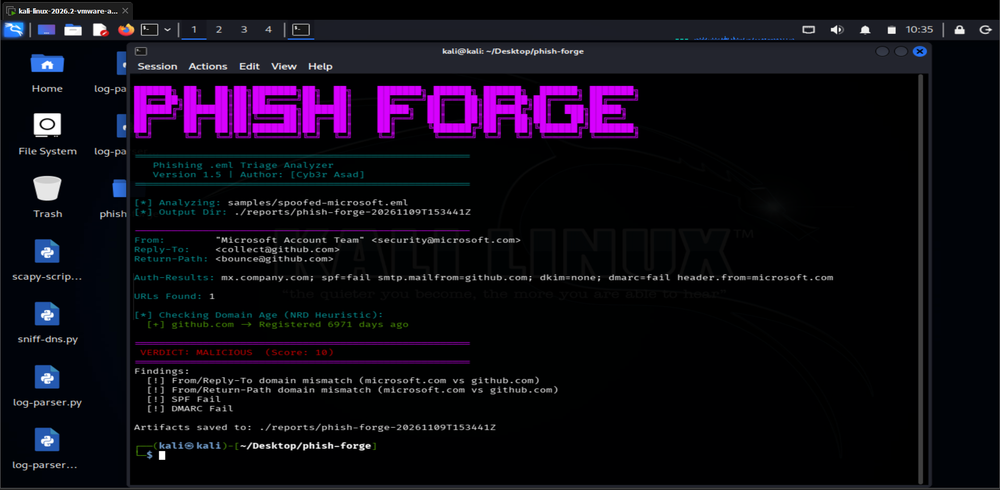

<div align="center">

```
██████╗ ██╗  ██╗██╗███████╗██╗  ██╗    ███████╗ ██████╗ ██████╗  ██████╗ ███████╗
██╔══██╗██║  ██║██║██╔════╝██║  ██║    ██╔════╝██╔═══██╗██╔══██╗██╔════╝ ██╔════╝
██████╔╝███████║██║███████╗███████║    █████╗  ██║   ██║██████╔╝██║  ███╗█████╗
██╔═══╝ ██╔══██║██║╚════██║██╔══██║    ██╔══╝  ██║   ██║██╔══██╗██║   ██║██╔══╝
██║     ██║  ██║██║███████║██║  ██║    ██║     ╚██████╔╝██║  ██║╚██████╔╝███████╗
╚═╝     ╚═╝  ╚═╝╚═╝╚══════╝╚═╝  ╚═╝    ╚═╝      ╚═════╝ ╚═╝  ╚═╝ ╚═════╝ ╚══════╝
```

### Phishing Email Triage Analyzer

**parse · authenticate · extract · enrich · verdict**

by **Asad (Cyb3r Asad)** — CS Student · Aspiring SOC Analyst · Blue Team


<br>



</div>

---

## Overview

Phishing remains one of the most common initial access vectors for attackers. For SOC Level 1 analysts, manually working through a reported `.eml` file means opening headers, checking SPF/DKIM/DMARC, digging out hidden URLs, and hashing attachments. That can take 10 to 15 minutes per email, which feeds alert fatigue and slows incident response.

Phish Forge takes a raw `.eml` file and produces a standardized threat report in seconds, so analysts can spend their time on investigation, containment, and response instead of repetitive data gathering.

## Key Capabilities

| Capability | What it does |
|---|---|
| Header spoofing detection | Compares `From`, `Reply-To`, and `Return-Path` domains to catch impersonation and lookalike domains |
| Email authentication | Parses `Authentication-Results` and flags SPF, DKIM, and DMARC failures |
| Payload extraction | Decodes MIME structures to extract obfuscated URLs and generates SHA256 hashes for attachments |
| Threat intel enrichment | Queries the VirusTotal API for the reputation of extracted domains |
| Scoring engine | Aggregates findings into a verdict: `MALICIOUS`, `SUSPICIOUS`, or `LIKELY CLEAN` |

## Example Run

Analysis of a simulated Microsoft 365 credential phish (`samples/phish-test.eml`):

| Check | Result |
|---|---|
| From domain | `micros0ft.com` (lookalike using a zero) |
| Reply-To domain | `evil-c2.tld` (mismatch) |
| Return-Path domain | `evil-c2.tld` (mismatch) |
| SPF | Fail |
| DKIM | None |
| DMARC | Fail |
| URLs extracted | 2 |
| VirusTotal | `micros0ft.com` flagged by 13 engines |
| Verdict | **MALICIOUS** (score 14) |

Every run saves its artifacts to a timestamped folder under `./reports/`.

> The sample email is synthetic. `evil-c2.tld` shows as clean on VirusTotal because it is a made-up domain.

## Tech Stack

| Component | Role |
|---|---|
| Bash | Orchestration, argument parsing, interactive terminal UI |
| Python (`email` module) | Robust MIME parsing and decoding |
| curl and jq | VirusTotal API requests and safe JSON handling |

## Installation

```bash
git clone https://github.com/cyb3erasad/phish-forge.git
cd phish-forge
chmod +x phish-forge.sh
```

**Requirements:** Bash 4+, Python 3, `curl`, `jq`, and a VirusTotal API key (a free key works, subject to rate limits).

The API key is read from an environment variable and is never stored in the script:

```bash
export VT_API_KEY="your_api_key_here"
```

## Usage

```bash
./phish-forge.sh samples/phish-test.eml
```

Output is written to `./reports/phish-forge-<timestamp>/`.

## Project Structure

```
phish-forge/
├── phish-forge.sh
├── samples/
├── reports/
├── docs/
│   └── screenshot.png
└── README.md
```

## Roadmap

- [ ] Attachment hash lookups against VirusTotal
- [ ] URL unshortening and redirect chain analysis
- [ ] JSON and HTML report export
- [ ] Batch mode for multiple `.eml` files

## Disclaimer

This tool is intended for defensive security work and education. Only analyze emails you are authorized to inspect.

---

<div align="center">

**Asad (Cyb3r Asad)** · [GitHub](https://github.com/cyb3erasad)

</div>